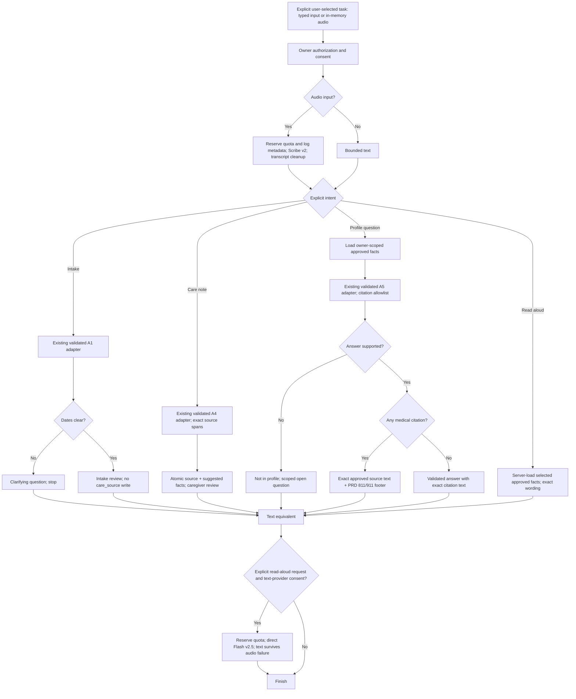

# ElevenLabs voice workflow

Issue #27 is an optional P1 foundation requested by Ali. It does not replace or
block the core real-email/Accept milestone (#6/#11) or the protected speech routes
in #16. The server workflow and hosted conversation graph are separate layers.
No HTTP routes, UI embedding, production model/store adapters or substitute access
are enabled by this change. Existing `lib/elevenlabs.ts` remains unchanged.

Current verification: 24 workflow fixtures, 6 hosted-configuration fixtures and
10 existing speech fixtures pass; TypeScript and the production build pass.
CLI onboarding confirms a working local key plus a declared/imported SDK.
Remote provisioning is **not complete**: the create API returns HTTP 400,
`input_invalid` / `invalid_parameters`, including for a minimal private setup
draft. The model catalog confirms both selected models exist, and SDK wire
serialization uses the documented snake-case fields. No successful agent ID or
conversation has been obtained. Keep this PR draft until that provider validation
failure is resolved; do not claim the hosted workflow is deployed or live-tested.

## System prompt

`lib/voice-agent/prompt.ts` holds the versioned, reviewable system prompt. It covers
the PRD's intake/profile separation, clarification before action, suggested-only
facts, approved citations, verbatim medical text, disclosure tiers, exact-item
approval, evidence-backed status, fictional data, consent and untrusted input.
These are model instructions. Authorization, validation and state controls remain
in application code. `voiceUntrustedData` is available to adapters that need the
PRD's delimiter format; it is not a substitute for the existing model validators.

The hosted foundation has no profile, email, calendar, external search, memory,
HTTP or mutation tools. Its prompt says those integrations are unavailable. It
explains an app path and finishes instead of claiming to save/send/approve. No
care records or personal documents are uploaded to its knowledge base.

## Application workflow

`createVoiceWorkflow(dependencies).execute(input, trustedContext)` runs exactly
one explicit task. Intent comes from an allowlisted application control, not a
model-selected tool. Unknown fields, operations and client-supplied identity are
rejected. The application supplies the authenticated owner, consent, current app
date and verified timezone separately from input.



| Intent | Input | Result and control |
|---|---|---|
| `intake` | `source:{type:"text",text}` or `{type:"audio",audio:Blob}` | A1 result with `needs_clarification` or `ready_for_review`; no care-source persistence or downstream impact/send |
| `care_note` | Source and `careRecipientId` | Exact-span facts saved only as `suggested`; audio source `kind:"voice"`, typed alternative `kind:"note"`, `s3Key:null` |
| `profile_question` | Source and `careRecipientId` | Approved-owner citation set only; unknown citations rejected; absence produces `Not in profile` plus a scoped open question |
| `read_aloud` | `careRecipientId`, selected `factIds` | Server-loaded approved text, never caller-supplied text; any medical citation adds the exact PRD footer |

The first three intents accept an explicit `speak:true` request. TTS text is
capped at 4,000 Unicode characters; longer content stays available as text with
`speechError:"text_too_long"`. Audio input is nonempty and at most 10 MB. The
existing adapter checks supported MIME types, uses Scribe v2 and deletes provider
transcripts when a `transcription_id` is returned. Missing IDs remain honestly
labelled `id_not_returned`; cleanup failure stops model processing/persistence.

Every paid STT/TTS/A1/A4/A5 call requires an atomic per-user quota reservation and
metadata-only start logging. Invalid model output fails validation; provider,
authorization and storage errors become fixed codes. No automatic retries occur.
The workflow has no approval, send, Calendar-write or request-state capability.
Recover remains the existing recorded-evidence application screen.

## Adapter responsibilities before exposure

1. Compose the existing server-only speech adapter and Fadi's validated A1/A4/A5
   services. Map their public contracts explicitly; do not introduce a replacement
   model or pass raw model output through. No live adapters are supplied here.
2. Authenticate every HTTP request, check same Origin on POST, enforce bounded
   input, and supply `trustedContext` server-side. Never deserialize identity or
   consent claims from a model tool call as trusted context. App consent must be
   explicit, purpose-specific and revocable. Audio/text provider consent is checked
   separately. This foundation requires fictional-data confirmation.
3. Implement `authorize` and every data operation with owner-scoped durable SQL.
   Substitute grants are unsupported; reject them. Recheck owner/recipient scope
   inside persistence transactions, not only before a model call.
4. `saveSuggestedVoiceNote` must atomically save text source/spans/suggested facts
   and reconcile conflicts with existing facts and events. The workflow does not
   implement A4 recurrence, timeline insertion or conflict resolution. Preserve
   the validated A4 result at the adapter boundary; do not silently discard its
   conflicts/timing. No newly proposed fact may become approved in this operation.
5. Reserve quota atomically using the durable per-user limit and write usage to
   `llm_call`; metadata callbacks contain IDs, step names, outcome/error codes only.
   Existing model services remain responsible for actual token/spend reporting.
   Never log raw input, source text, answers, provider bodies, credentials or links.
6. Provide visible typed alternatives, review screens and citations. Read medical
   output using the direct server TTS path; never feed it back to the hosted router
   for rephrasing. The application remains responsible for the PRD's exact-item
   approval/revision guard and health-term checks.

## Private hosted foundation

`config.ts` builds a seven-node graph using the official SDK `Workflow` builder:
start → choose path → one of urgent intake/care note/profile question/review in
app → end. The graph has no backward edges and prevents subagent loops. LLM edge
conditions select navigation only and carry no permission to access data or act.

This optional navigation layer uses hosted `gpt-oss-120b` with temperature 0 and a
400-token response cap. It does not change the project's Bedrock model/provider
decision or A1–A6 implementation. ASR is `scribe_realtime` for the optional hosted
conversation; the PRD application path still uses batch Scribe v2. TTS is explicit
Flash v2.5 with a stock voice, never a cloned voice.

The configuration requires signed authorization (`enableAuth:true`), disables
client workflow/procedure overrides, recording, monitoring and file input, and
sets retention to 0 with transcript/audio deletion requested. Retention 0 means
scheduled provider deletion, not an enterprise zero-retention guarantee or proof
that all debugging logs/backups disappear. No signed URL, public widget, phone
connection or conversation is created by provisioning. Future token issuance
must check the application session, consent and quota first.

Limits are one concurrent call, ten calls/day, 180 seconds per call, no bursting
and no queue. Focus, prompt-injection and two blocking custom guardrails provide
additional model checks. Custom guardrails can fail open; they are not permission
or clinical-safety enforcement. No claims of HIPAA/HIA compliance or Canadian
residency are made.

## Provisioning and checks

The SDK reads `ELEVENLABS_API_KEY` from the environment. Next.js loads ignored
`.env.local`; standalone Node can use `--env-file=.env.local`. Do not print, commit
or paste that file. `ELEVENLABS_VOICE_ID` is optional for provisioning and otherwise
uses the stock Sarah voice from the official skill.

```sh
# No network or key needed: inspect the proposed configuration summary.
node --conditions=react-server --import tsx scripts/elevenlabs/provision-agent.ts --preview

# Create once, record its non-secret ID in ignored .board/elevenlabs-agent.json,
# then read back and check the requested configuration. Starts no conversation.
node --env-file=.env.local --conditions=react-server --import tsx scripts/elevenlabs/provision-agent.ts --create

# Read-only verification of the recorded agent. Never overwrites another agent.
node --env-file=.env.local --conditions=react-server --import tsx scripts/elevenlabs/provision-agent.ts --verify

node --conditions=react-server --import tsx --test tests/voice-agent*.test.ts tests/speech.test.ts
npm run typecheck
npm run build
npx -y @elevenlabs/cli@latest onboard check --answered --env-path .env.local
```

Provisioning first establishes the private agent with mandatory authentication,
privacy and cost controls, records its ID, then applies the optional graph and
guardrails. A failed update leaves it private and unverified. Rerunning `--create`
with an unverified receipt checks the name/tag before updating that same agent;
it does not create a duplicate. No existing unrelated agent is updated.

The create API has automatic retries disabled. After a timeout or uncertain
failure, inspect the receipt/dashboard before any manual repeat to avoid duplicate
agents. `--verify` checks requested settings, complete topology, node instructions,
disabled overrides and absence of business tools; it does not prove conversational
behavior. No application start, real audio, synthetic speech or paid conversation
test is authorized just by running the checks above. Ask the developer before
the first live speech test, as required by the CLI onboarding instructions.

## References

- Repository PRD: U1, C1–C4, C6/C8, request approval/state rules and section 9.
- Repository implementation guide: sections 6 (bounded validated steps), 7
  (Scribe/Flash, transcript deletion) and 12 (authorization/rate limits/logging).
- [Official SDK workflow builder](https://elevenlabs.io/docs/eleven-agents/customization/agent-workflows-as-code)
- [Agent authentication](https://elevenlabs.io/docs/eleven-agents/customization/authentication)
- [Retention settings](https://elevenlabs.io/docs/eleven-agents/customization/privacy/retention)
- [Agent creation API](https://elevenlabs.io/docs/api-reference/agents/create)
- Official ElevenLabs Agents skill downloaded during CLI onboarding; application
  code and prompts are versioned here rather than copied into external tools.
